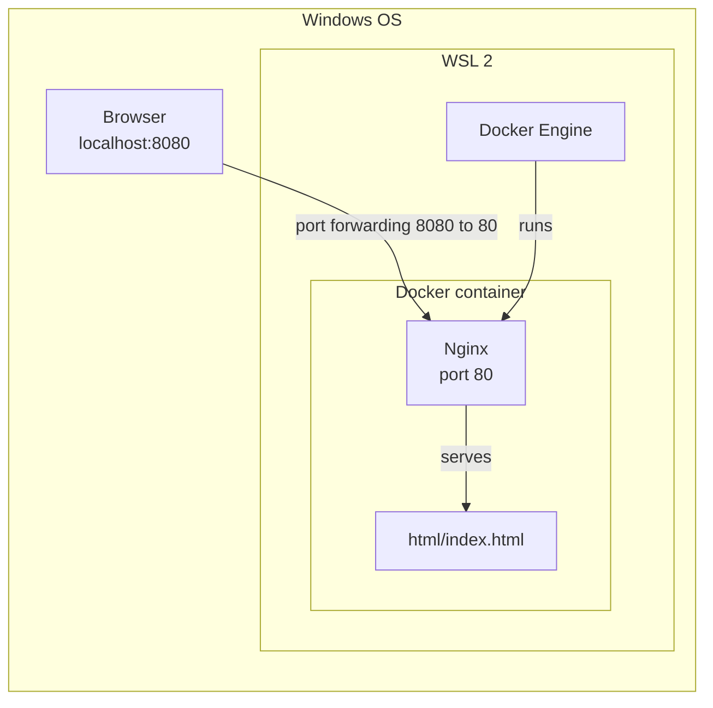

# Run Nginx with Docker on WSL 2

A small sample project for running Nginx with Docker from WSL 2.

## Overview



## Requirements

- Windows 10 or 11 with WSL 2
- Docker Desktop for Windows, with WSL integration enabled for your Linux distribution

## Run

In your WSL terminal, go to this project directory and run:

```sh
docker compose up --build
```

Open <http://localhost:8080> in your Windows browser. Press `Ctrl+C` to stop.

## Useful commands

Run in the background:

```sh
docker compose up --build -d
```

View logs:

```sh
docker compose logs -f
```

Stop and remove the container:

```sh
docker compose down
```

Edit `html/index.html` to change the sample page. Keep the project in the WSL filesystem for best performance.
